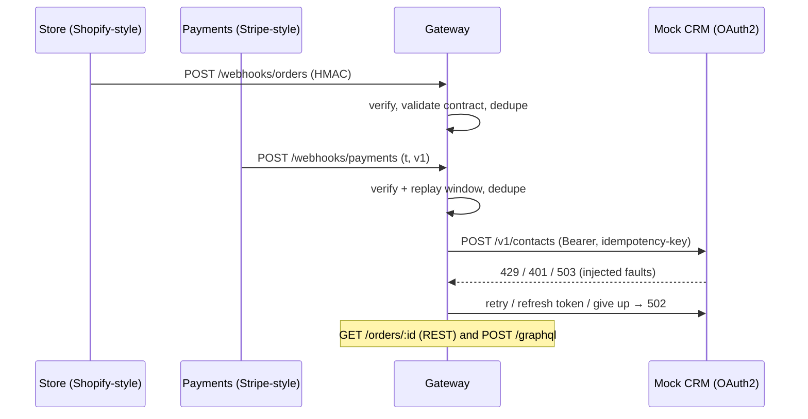
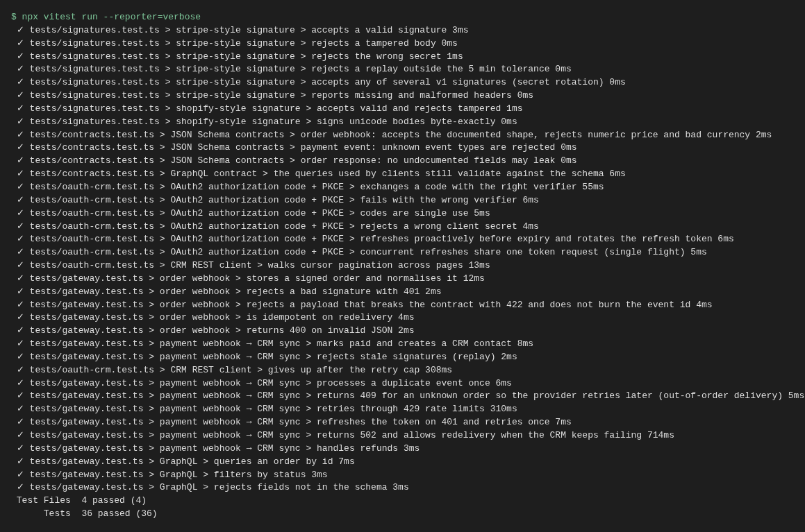
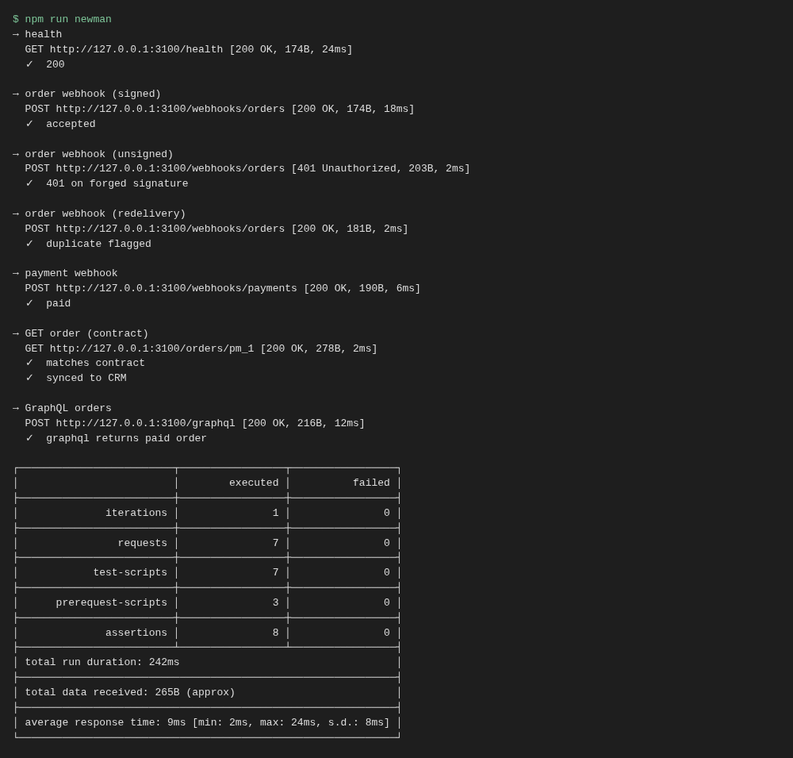

# Webhook Sync Gateway: signed webhooks → OAuth2 CRM sync, with contract tests

[](https://github.com/lrm22221-afk/webhook-sync-gateway/actions/workflows/ci.yml)

A portfolio demo, not client work. A small TypeScript service that shows the parts of API integration work that usually break in production:

- **Webhook verification** in two common styles: Stripe-style (`t=…,v1=…` HMAC over `timestamp.body`, 5-min replay window, multiple signatures for secret rotation) and Shopify-style (base64 HMAC of the raw body). Timing-safe comparison.
- **Idempotency**: redelivered events are processed once. Events that fail (bad contract, unknown order, CRM down) are *not* marked as seen, so the provider's retry can succeed.
- **Out-of-order delivery**: a payment that arrives before its order gets a 409 so the provider retries.
- **OAuth2** authorization code + **PKCE** against a mock CRM: single-use codes, refresh-token rotation, proactive refresh before expiry, single-flight refresh, refresh-and-retry on 401.
- **REST client resilience**: 429 `Retry-After` handling, 5xx backoff with a retry cap, cursor pagination, idempotency keys.
- **Contracts**: JSON Schema (Ajv) for incoming webhooks and outgoing responses (no undocumented fields can leak), a GraphQL schema, and a **Postman collection run by Newman** in CI.



## Run
```bash
npm ci
npm test          # 36 vitest tests
npm run newman    # Postman collection, 7 requests / 8 assertions
npm start         # gateway on :3000, mock CRM on :3001
```
Secrets in the repo (`whsec_demo`, `shop_demo`, `demo-secret-not-real`) are fake demo values. Real ones are read from `PAYMENT_WEBHOOK_SECRET` / `ORDER_WEBHOOK_SECRET`.

## Tests (36 + Newman)
- `signatures.test.ts` (8): valid, tampered, wrong secret, stale replay, rotation, malformed, unicode body.
- `gateway.test.ts` (16): end to end through real HTTP: signature failures, contract 422 without burning the event id, redelivery, out-of-order 409, 429 retries, token expiry → refresh, CRM outage → 502 → successful redelivery, refunds, GraphQL.
- `oauth-crm.test.ts` (8): PKCE success and failure, single-use codes, bad client secret, proactive refresh, single-flight, pagination, retry cap.
- `contracts.test.ts` (4): JSON Schema and GraphQL client queries.




## Honest limitations
- The CRM and both webhook senders are **mocks** shaped like common providers. This is not the real Stripe, Shopify or HubSpot API, and nothing here was tested against those live services.
- The store is in memory. Production needs a database with a unique constraint on event ids, and a queue so the webhook can return 200 before the CRM call.
- The 5-min replay window relies on server clock sync.
- Real OAuth needs an app registered with the provider and secure token storage (encrypted, per tenant). The mock skips consent screens and scopes enforcement.
